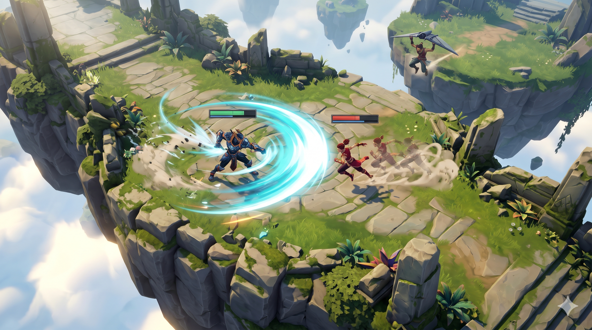
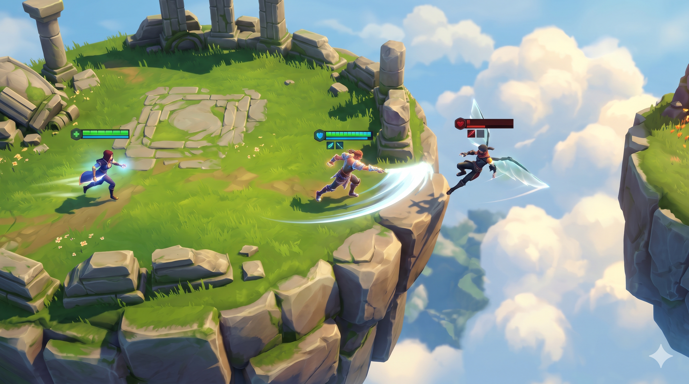
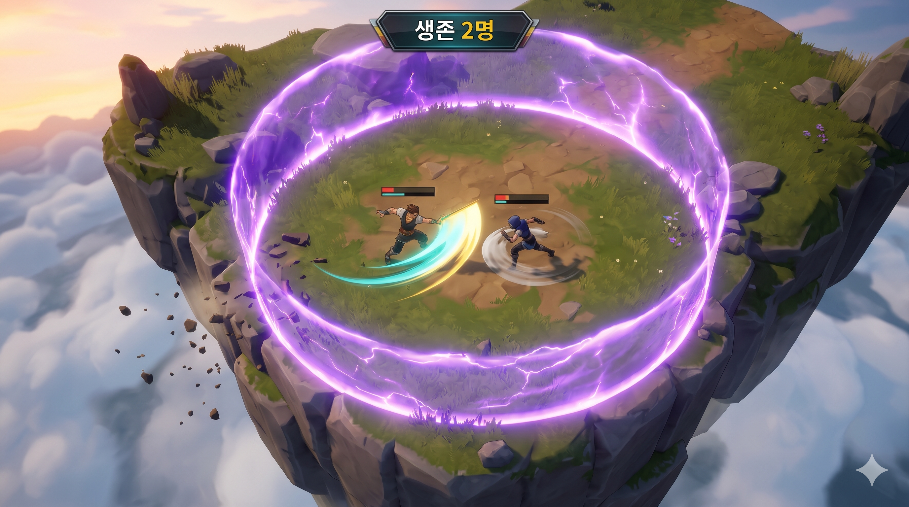

# SkyBout — 게임 기획서

### 공격을 피하고, 빈틈을 노리고, 마지막까지 살아남아라.

## 1. 게임 개요

**SkyBout는 하늘섬을 무대로, 여러 플레이어가 직접 움직이며 공격하고 마지막 한 명이 될 때까지 싸우는 소규모 온라인 탑뷰 생존 액션 게임입니다.**

상대의 공격을 피하면서 내 공격을 맞히고, 유리할 때는 압박하며 불리할 때는 교전에서 벗어납니다. 점프와 글라이딩은 이런 싸움에 진입하고 빠져나오는 수단입니다. 시간이 지날수록 안전 구역이 좁아져, 살아남은 플레이어들은 더 제한된 공간에서 승부를 겨룹니다.

**섬을 많이 차지하거나 먼저 목적지에 도착하는 게임이 아닙니다. 상대를 쓰러뜨리고 내가 살아남는 것이 목표이며, 하늘섬과 낭떠러지는 그 싸움에 위험과 변수를 더하는 전장입니다.**

| 항목 | 내용 |
| --- | --- |
| 장르 | 소규모 온라인 생존 액션 / 배틀로얄 |
| 대전 방식 | 각자 자신의 생존과 승리를 겨루는 개인전 |
| 시점 | 캐릭터·상대·주변 지형을 함께 읽는 탑뷰 |
| 핵심 경험 | 공격과 회피의 공방, 압박과 추격, 이탈 후 재교전 |
| 전장 | 같은 높이에 떠 있는 여러 하늘섬과 바닥 없는 낭떠러지 |
| 승리 조건 | 체력 소진과 낙사를 피하고 최후의 1인으로 생존 |

*대표 교전 — 상대의 공격에 대응하며 내 공격 기회를 만드는 액션 대전.*

> 이 문서의 이미지는 플레이 경험을 표현한 AI 생성 콘셉트 이미지입니다. 실제 게임 화면이 아니며, 캐릭터·공격 효과·잔상·UI는 예시로서 별도 직업·스킬·회피기 등의 규칙을 의미하지 않습니다.

## 2. 기획 의도

### 단순한 조작으로, 상대와 주고받는 싸움에 집중한다

원하는 재미는 공격 버튼을 계속 누르는 것만으로 결정되는 전투가 아닙니다. 상대의 움직임을 보고 공격 기회를 만들고, 상대가 대응하면 다시 움직이는 공방입니다. 같은 상대와 싸우더라도 거리, 남은 체력, 주변의 다른 플레이어에 따라 선택이 달라져야 합니다.

예를 들어, 체력이 적은 상대를 발견했다고 무조건 쫓아가면 다른 플레이어에게 공격받을 수 있습니다. 반대로 불리하다고 도망치기만 하면 자기장 때문에 움직일 공간이 줄어듭니다. **공격할 실력과 싸움을 계속할지 판단하는 능력을 함께 요구하는 것**이 목표입니다.

### 규모는 줄이되, 전투의 연결은 남긴다

1인 개발에 맞춰 소규모 개인전과 기본 공격 한 종류를 중심으로 구성합니다. 다양한 캐릭터·능력·장비를 대량으로 준비하는 대신, **공격 → 회피 → 압박 → 추격 또는 이탈 → 재교전**이 자연스럽게 이어지는 경험에 집중합니다.

점프·글라이딩·낙사·자기장은 별도의 미니게임이 아니라 이 전투 흐름을 바꾸는 요소입니다. 싸움에서 달아나기 위해 비행할 수도 있고, 접근해 착지한 뒤 공격을 시작할 수도 있습니다. 다만 비행에 성공했다고 체력이 회복되거나 전투에서 승리하는 것은 아닙니다.

## 3. 레퍼런스 역기획 — 슈퍼바이브

> 아래는 공개된 공식 소개와 플레이 기사에서 확인한 **원작의 구조**와, 그 구조가 만드는 재미에 대한 **기획적 해석**입니다. 원작의 기능을 모두 SkyBout에 도입한다는 뜻은 아닙니다. 초기 플레이 자료와 1.0의 변경 사항은 구분합니다.

### ① 전투의 기본은 ‘직접 움직이며 맞히고 피하는 것’이다

**원작의 구조:** 슈퍼바이브는 WASD 이동과 방향을 겨냥하는 공격, 헌터별 능력과 이동기를 결합합니다. 공개 플레이 기사에서는 공격을 직접 맞히는 스킬샷 공방과 빠르게 방향을 바꾸며 상대를 속이는 움직임을 주요 특징으로 설명합니다. 단순히 상대를 선택해 공격하는 것보다 직접 조작의 비중이 큽니다. [자료 1]

**재미의 원리:** 공격이 성공할지는 상대의 움직임에도 달려 있습니다. 공격하는 쪽은 맞힐 기회를 만들고, 방어하는 쪽은 움직임으로 피해를 피하려 합니다. 양쪽 모두 계속 판단하고 조작하기 때문에, 전투 자체가 능동적인 경험이 됩니다.

**SkyBout에 반영할 점:** 기본 공격 한 종류로 시작하더라도, 상대와의 거리·공격 기회·피할 방향을 읽는 공방을 중심에 둡니다. 공격 수를 늘리는 것으로 깊이를 대신하지 않습니다. 공격의 구체적인 형태와 무관하게 **움직이면서 공격하는 상대에게 어떻게 대응할지**가 전투 설명의 중심입니다.

### ② 이동은 전투 전후의 이동 시간이 아니라, 전투의 일부다

**원작의 구조:** 헌터별 이동기, 점프, 글라이딩이 접근과 이탈에 쓰입니다. 지상에서 시작한 교전이 낭떠러지 주변이나 공중으로 이어지고, 도망가는 상대를 계속 압박할지 판단하게 됩니다. [자료 1·2]

**재미의 원리:** 피해를 주고받은 뒤에도 승부가 곧바로 끝나지 않습니다. 유리한 쪽은 추격해서 마무리할 기회를 찾고, 불리한 쪽은 상대의 압박에서 벗어나 상황을 바꾸려 합니다. 이때 추격하는 사람도 위치를 바꾸고 위험을 감수하므로, 우세와 열세가 바뀔 여지가 생깁니다.

**SkyBout에 반영할 점:** 점프와 글라이딩을 ‘다음 섬에 도달하는 방법’만으로 설명하지 않습니다. 교전 진입, 추격, 이탈 후 재접근을 연결하는 공통 이동 수단으로 사용합니다. 단, 점프에 무적이나 공격 회피 보너스가 있는 것처럼 가정하지 않습니다.

### ③ 낭떠러지는 공중 이동을 안전한 탈출 버튼으로 만들지 않는다

**원작의 구조:** 초기 공개 플레이에서는 글라이딩 중 피격이 스파이크와 추락으로 연결되는 위험이 강조됩니다. 2025년 7월 1.0 공식 소개에서는 비행 연료 제한을 없애고, 장시간 비행과 피격으로 증가하는 과열 게이지를 도입했습니다. 과열 시 감속·지속 피해·적 공격에 의한 스파이크 위험이 생깁니다. 따라서 **‘글라이딩 중 한 대 맞으면 항상 즉시 추락’이라는 설명을 모든 버전에 적용할 수는 없습니다.** [자료 1·3]

**재미의 원리:** 이동은 강력하지만 항상 안전하지는 않습니다. 원작은 비행에 따른 위험을 통해 추격자와 도망가는 사람의 상호작용을 유지합니다. 땅이 없는 공간은 단순한 빈 배경이 아니라, 이동을 선택할 때 감수할 위험입니다.

**SkyBout에 반영할 점:** 낙사와 착지 실패의 위험을 사용하되, 원작의 스파이크·과열·피격 시 강제 접기를 그대로 포함하지 않습니다. **SkyBout의 비행 높이 보정은 원작과 다른 규칙이며, 그것만으로 원작의 공중 교전이 재현된다고 보지 않습니다.** 지상 공방과 진입·이탈의 연결에 초점을 맞춥니다.

### ④ 자기장은 ‘어디에 갈까’보다 ‘언제까지 싸울 수 있을까’를 바꾼다

**원작의 구조:** 줄어드는 안전 구역 안에서 다른 팀과 교전하며, 지도상의 여러 목표와 보상을 두고 경쟁합니다. 적과의 전투뿐 아니라 주변 상황을 함께 읽어야 합니다. [자료 1·2]

**재미의 원리:** 유리한 싸움도 오래 끌면 다른 적이 개입하거나 안전 구역 밖에 남을 수 있습니다. 전투에 시간 제한과 외부 변수가 생기면서, 공격을 계속하는 것이 항상 정답은 아니게 됩니다.

**SkyBout에 반영할 점:** 점령 보상이나 자원 거점을 중심에 두지 않고, 자기장으로 교전의 지속 시간과 행동 공간에 압박을 줍니다. 상대를 마무리하려고 버틸지, 피해가 더 커지기 전에 교전을 끊을지 판단하게 합니다.

### ⑤ 원작의 깊이 전체를 기본 공격 하나로 대체할 수는 없다

**원작의 구조:** 헌터별 능력, 팀 조합, 성장과 장비, 아군 부활 등 여러 시스템이 전투 결과에 영향을 줍니다. 1.0에서는 장비 구성과 성장을 위한 Armory도 강화되었습니다. [자료 2·3]

**SkyBout의 재구성:** 팀 합과 빌드의 깊이를 그대로 가져오는 대신, 개인이 수행하는 공격·회피·생존 판단에 범위를 좁힙니다. 다양한 능력의 연계나 팀원의 구출을 약속하는 게임이 아니라, **작은 규모에서 상대의 움직임을 읽고 대응하는 액션 대전**을 목표로 합니다.

| 요소 | SkyBout에서의 취급 |
| --- | --- |
| 공격을 맞히고 피하는 직접 조작 | 핵심으로 유지할 경험 |
| 접근·압박·추격·이탈의 연결 | 핵심으로 유지할 전투 흐름 |
| 점프·글라이딩·낭떠러지 | 공통 이동 수단과 전투 지형으로 재구성 |
| 안전 구역 축소 | 전투에 시간 압박과 외부 변수를 부여 |
| 팀별 역할·부활·다수 헌터·장비 빌드 | 이번 소규모 개인전의 핵심 범위에 포함하지 않음 |
| 스파이크·과열·헌터별 이동기 | 원작 분석과 구분하며 SkyBout의 기본 규칙에 추가하지 않음 |

## 4. 타겟 사용자

**핵심 타겟은 캐릭터를 직접 움직이며 공격을 맞히고 피하는 액션 대전을 좋아하고, 복잡한 팀 역할이나 많은 사전 지식보다 한 판의 공방에 집중하고 싶은 플레이어입니다.**

| 사용자 | 기대하는 재미 | 제공할 경험 |
| --- | --- | --- |
| 직접 조작하는 액션 PvP를 즐기는 사람 | 상대를 읽고 내 조작으로 이기는 손맛 | 이동하면서 공격 기회를 만들고 상대의 공격에 대응하는 공방 |
| 복잡한 능력·장비 학습이 부담스러운 대전 관심자 | 기본 행동은 쉽게 배우되 숙련의 차이는 느끼기 | 적은 행동으로 시작해 거리 조절·공격 타이밍·추격 판단을 익힘 |
| 지인과 서로 겨루고 싶은 사람 | 내 선택으로 승패가 갈리고 다음 판에 설욕하기 | 같은 방에서 반복하는 소규모 개인 생존 대전 |

승리의 기억은 ‘좋은 섬을 차지했다’보다 **‘상대 공격을 피하고 반격했다’, ‘추격을 끊고 살아남았다’, ‘마지막 교전에서 이겼다’**에 남도록 합니다.

## 5. 핵심 플레이 — 한 번의 교전은 어떻게 이어지는가?

**상대 발견 → 공격 기회 만들기 → 피해 교환과 압박 → 추격 또는 이탈 → 마무리 또는 재교전**

| 순간 | 플레이어의 판단과 행동 | 의도한 재미 |
| --- | --- | --- |
| 상대 발견 | 상대와 내 체력, 거리, 주변의 다른 적을 보고 접근 여부를 결정 | 싸움의 주도권을 잡으려는 긴장 |
| 첫 공방 | 상대의 공격에 맞춰 움직이고, 내 공격을 맞힐 기회를 찾음 | 상대를 읽고 대응하는 손맛 |
| 유불리 발생 | 유리하면 압박하고, 불리하면 거리를 벌리며 대응 | 짧은 판단으로 바뀌는 우세와 열세 |
| 추격·이탈 | 점프와 글라이딩으로 이어갈지, 위험한 추격을 멈출지 결정 | 놓치기 싫은 욕심과 살아남아야 하는 긴장 |
| 마무리·재교전 | 체력이 소진된 상대를 탈락시키거나, 접촉이 끊긴 뒤 다시 싸움 | 처치의 성취감 또는 재도전의 기회 |

여러 명이 각자 싸우므로, 내 앞의 상대만 위협은 아닙니다. 두 사람이 교전하는 동안 다른 플레이어가 끼어들 수 있습니다. 체력이 적은 적을 쫓다가 오히려 내가 공격받을 수도 있습니다. **개인전의 변수는 섬의 소유권이 아니라 상대들의 행동과 남은 체력입니다.**

*압박과 이탈 — 도망가는 상대를 끝까지 쫓을 것인가, 다가오는 다른 적에게 대응할 것인가.*

## 6. 주요 시스템과 역할

### 전투 — 기본 공격으로 주고받는 공방

기본 공격 한 종류와 체력을 사용합니다. 공격을 통한 체력 감소가 상대를 탈락시키는 기본 수단입니다. 공격의 종류를 늘리기보다, 상대의 접근에 대응하고 공격 기회를 만드는 움직임이 중요하도록 구성합니다.

전투의 속도는 상대에게 대응할 여지가 있으면서도, 공격을 성공시켰을 때 압박이 느껴지는 방향을 목표로 합니다. 서로 멈춰 선 채 체력만 비교하거나, 이동만 반복해 승부가 나지 않는 경험은 지양합니다. 공격의 성공과 체력 변화는 시각적으로 분명하게 전달하고 온라인에서도 같은 결과가 적용되도록 합니다.

### 이동 — 공방의 거리와 접촉을 바꾸는 수단

WASD로 지상과 공중에서 이동합니다. 지상에서는 상대와의 거리를 조절하고, 점프와 글라이딩은 전장 사이를 오가며 접근·추격·이탈하는 데 사용합니다. 걷거나 날았다는 사실 자체가 점수나 승리가 되지는 않습니다.

지상에서 Space를 누르면 정해진 높이까지 점프한 뒤 내려옵니다. 키를 놓았다가 공중에서 다시 누르고 유지하면 글라이더를 펼칩니다. 글라이딩 중 키를 놓으면 접고 하강합니다. **점프가 무적 회피기라는 규칙이나, 비행 중 별도의 공격 능력은 부여하지 않습니다.**

글라이딩 중에는 정해진 비행 높이보다 낮으면 올라가고 높으면 내려가 자연스럽게 그 높이에 맞춰집니다. 고도 조절보다 상대와의 관계와 이동 방향에 집중하게 합니다. 섬 위에서 접으면 착지하고, 바닥 없는 곳에서 접으면 추락합니다.

### 전장 — 지상 공방을 할 공간과 이탈할 위험

하늘섬의 윗면은 모두 같은 높이이며, 섬 사이에는 바닥이 없습니다. 섬은 단순한 징검다리가 아니라 **한 공간 안에서도 접근하고, 공격에 대응하고, 거리를 벌릴 수 있는 전투 무대**로 구성합니다. 가장자리는 추락을 주의해야 하는 경계이고, 틈은 접근과 이탈의 방법을 바꿉니다.

섬에 소유권·점령 점수·점령 유지 보상은 없습니다. 넓은 섬을 차지해도 상대를 쓰러뜨리거나 끝까지 살아남지 못하면 승리할 수 없습니다. 탑뷰 카메라는 플레이어를 따라가며 상대의 행동, 공격 효과, 위험한 가장자리를 함께 읽게 합니다.

### 자기장 — 공방을 오래 끌 수 없게 만드는 압박

안전 구역 밖에서는 자기장으로 지속 피해를 받습니다. 시간이 지날수록 안전 구역이 좁아지며, 섬 자체가 줄어드는 것이 아니라 피해 없이 활동할 수 있는 범위가 줄어듭니다.

상대와 싸우는 중에도 자기장은 다가옵니다. 눈앞의 적을 마무리하려다 자기장 피해를 받을 수 있고, 싸움을 끊고 이동하는 동안 다른 상대를 만날 수 있습니다. 자기장은 특정 땅을 소유하게 하는 장치가 아니라 **교전의 시간과 움직일 여유를 제한해 승부를 진전시키는 장치**입니다.

### 탈락과 승리 — 마지막까지 살아남는 개인전

체력이 소진되거나 발 위치가 정해진 낙사 높이 아래로 내려가면 해당 경기에서 탈락합니다. 낙사로 탈락한 뒤 글라이더를 펼쳐 되살아날 수 없으며, 경기 중 부활은 없습니다.

남은 생존자 수를 표시하고 마지막 한 명에게 우승을 부여합니다. 경기 종료 후에는 같은 방에서 새 경기를 시작합니다. 처치 수나 점령 면적이 아니라 **최후의 생존 여부**가 승리를 결정합니다.

## 7. 한 경기의 흐름

| 구간 | 벌어지는 일 | 플레이어가 느낄 경험 |
| --- | --- | --- |
| 준비 | 방을 생성하거나 참가해 같은 맵에서 경기를 시작 | 함께 겨룰 준비 |
| 초반 | 상대와 처음 맞붙고 공격·대응 방식을 파악 | 탐색전과 첫 공격의 긴장 |
| 중반 | 피해를 주고받고, 추격·이탈·다른 적의 개입이 발생 | 우세와 열세가 바뀌는 공방 |
| 후반 | 안전 구역과 생존자 수가 줄어 교전을 피할 여유도 감소 | 제한된 공간에서 공격과 생존을 함께 판단 |
| 결승 | 마지막 생존자들 사이의 교전으로 최후의 1인을 결정 | 마지막 상대를 이겨 낸 성취감 |
| 재경기 | 같은 방에서 새 경기 시작 | 이전 실수를 바꾸고 설욕하려는 동기 |

*마지막 공방 — 물러날 공간이 줄어든 전장에서 최후의 1인을 가리는 순간.*

## 8. 사용자 시나리오

### 처음 하는 플레이어 — “계속 공격하기보다, 상대를 보고 움직여야 하는구나.”

지인의 방에 들어온 플레이어는 상대에게 다가가 공격을 반복하지만, 상대가 움직이며 대응하는 동안 자신은 피해를 받고 탈락합니다. 다음 경기에는 공격만 누르지 않고 상대의 접근에 맞춰 거리를 바꿉니다. 상대의 공격을 피하고 자신의 공격을 성공시키면서, 처음으로 교전에서 우세를 잡습니다.

**기대 경험:** 배워야 할 능력이 많아서가 아니라, 같은 행동을 언제 어떻게 쓰는지에 따라 결과가 달라진다는 것을 느낍니다. 첫 성취는 섬 이동 성공보다 **“상대에게 대응해서 이겼다”는 감각**에 둡니다.

### 액션 대전을 즐기는 플레이어 — “잡을 수 있지만, 끝까지 쫓아도 될까?”

상대의 체력을 줄여 우세를 잡은 플레이어가 도망가는 적을 압박합니다. 상대가 글라이딩으로 이탈하자 따라가려 하지만, 옆에서 다른 플레이어가 접근합니다. 무리하게 한 명을 쫓는 대신 방향을 바꿔 새 공격에 대응합니다. 처치 기회를 놓친 아쉬움은 있지만, 뒤를 노린 적에게 당하지 않고 다음 공방을 이어갑니다.

**기대 경험:** 공격에 성공한 뒤에도 자동으로 승리가 보장되지 않습니다. **마무리하려는 욕심과 살아남기 위한 판단**이 충돌하며, 상황을 읽는 능력이 전투 실력의 일부가 됩니다.

### 불리한 플레이어 — “도망쳐 끝내는 게 아니라, 다시 싸울 기회를 만들자.”

피해 교환에서 밀린 플레이어가 거리를 벌리고 글라이딩으로 교전을 끊습니다. 착지한 뒤 체력이 낮은 상태 그대로 주변을 확인합니다. 쫓아온 상대가 접근하자 그 움직임에 대응하며 다시 공격 기회를 찾습니다. 이탈은 체력을 회복시키거나 역전을 보장하지 않지만, 일방적으로 맞던 상황에서 다시 판단할 기회를 만듭니다.

**기대 경험:** 불리해져도 조작과 선택을 포기하지 않게 합니다. **이탈 후 재교전**이 연결되면서, 체력이 적어도 상대에게 대응하는 긴장감을 유지합니다.

### 지인과 경쟁하는 플레이어 — “이번 판에는 마지막 공방에서 이기겠다.”

마지막 두 명이 남고 자기장 때문에 물러날 공간이 줄어듭니다. 이전 경기에서 상대를 무리하게 쫓다가 패했던 플레이어는 이번에는 자신의 체력과 상대의 움직임을 함께 봅니다. 상대의 공격에 대응하고 반격을 성공시켜 마지막 생존자가 됩니다. 새 경기를 시작하며 서로 어느 공방에서 승부가 갈렸는지 이야기합니다.

**기대 경험:** 승패를 섬 배치나 유리한 땅만의 결과로 느끼기보다 **내가 한 공격과 대응, 무리하거나 참았던 순간**으로 기억하게 합니다. 이것이 재경기의 동기가 됩니다.

---

### 레퍼런스 분석 자료

원작 분석은 다음 공개 자료를 바탕으로 작성했습니다. 기능과 수치는 시기별로 달라질 수 있으며, 위의 ‘재미의 원리’는 자료를 바탕으로 한 기획적 해석입니다.

- **[자료 1]** [PC Gamer, 2024-10-15 플레이 기사](https://www.pcgamer.com/games/battle-royale/flashy-moba-battle-royale-supervive-is-opening-its-doors-during-steam-next-fest-and-its-already-got-that-blizzard-riot-polish-from-its-expat-devs-in-spades/) — 초기 스킬샷 공방, 이동, 글라이딩 중 피격 위험, 배틀로얄 구조.
- **[자료 2]** [GamesBeat, 2024-06-25 공개 소개 및 개발진 발언](https://gamesbeat.com/theorycraft-unveils-hero-battle-royale-supervive-coming-to-open-beta-this-year) — 능력·이동·환경 상호작용, 팀 전투, 장비와 부활 구조.
- **[자료 3]** [NEXON, 2025-07-24 공식 1.0 출시 안내](https://jp.nexon.com/news/135724) — Armory, 지도 변경, 글라이더 과열과 스파이크 조건 변화.
