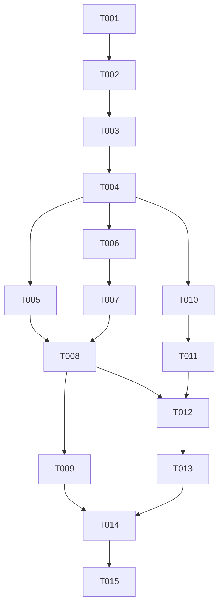

# Tasks: 하늘섬 기본 이동과 탑뷰 카메라

**Input**: `specs/001-island-movement-camera/`의 [spec.md](spec.md), [plan.md](plan.md), [research.md](research.md), [data-model.md](data-model.md), [입력 계약](contracts/player-controls.md), [quickstart.md](quickstart.md)

**Organization**: US1은 하늘섬 지상 이동(P1), US2는 캐릭터 추적 카메라(P2)다. 이번 파일은 작업 정의이며 체크는 실제 수행·검증 후에만 한다.

**Tests**: 계획에 정의된 작은 PlayMode 회귀 검사로 이동 속도 측정과 비단순 이동 분기를 검증한다. 실제 키보드·OS 초점·화면 구도·조작감은 별도 플레이로 확인한다. 광범위한 테스트 체계나 커버리지 목표는 추가하지 않는다.

## Format: `[ID] [P?] [Story] Description`

- `[P]`는 선행 작업이 끝난 뒤 다른 파일 작업과 병행할 수 있다는 뜻이다. 같은 씬·같은 테스트 파일은 동시에 수정하지 않는다.
- `[US1]`, `[US2]`는 명세의 두 사용자 이야기에 대응한다.
- 경로는 저장소 루트 기준이다. 기존 `.meta` GUID와 씬 참조는 보존하고, 새 Unity 자산의 `.meta`도 함께 관리한다.
- Unity가 열려 있으면 씬/자산 편집은 Editor 또는 Unity CLI/Pipeline으로 수행한다. 사용자의 열린 Editor를 테스트 때문에 임의로 닫지 않는다.

## Phase 1: Setup — 기존 프로젝트 확인

**Purpose**: 새 프로젝트를 만들지 않고 현재 프로토타입을 실행할 준비와 기준 상태를 확인한다.

- [ ] T001 `ProjectSettings/ProjectVersion.txt`의 Unity 6000.3.26f1과 `Packages/manifest.json`의 기존 패키지를 사용해 프로젝트 임포트·컴파일 및 `Assets/Scenes/SampleScene.unity`의 초기 상태를 확인하고, 실행 여부/기존 오류를 `specs/001-island-movement-camera/quickstart.md`의 검증 기록에 남긴다. 패키지 업그레이드나 새 프로젝트 생성은 하지 않는다.

## Phase 2: Foundational — 공통 검증 기반

**Purpose**: 두 이야기에서 사용할 실제 컴포넌트 참조와 최소 입력 시험 기반을 마련한다. T001 이후 수행하고, 이 단계가 끝난 뒤 사용자 이야기 구현을 시작한다.

- [ ] T002 `Assets/Scripts/SkyBout.Runtime.asmdef`와 `Assets/Tests/PlayMode/SkyBout.PlayModeTests.asmdef`를 추가해 런타임의 Unity.InputSystem 및 PlayMode 테스트의 런타임/Input System/Test Runner 참조를 구성하고 컴파일을 확인한다. 기존 `Assets/Scripts/PlayerMovement.cs.meta`와 씬 스크립트 참조를 보존한다.
- [ ] T003 `Assets/Tests/PlayMode/MovementAndCameraTests.cs`에 실제 PlayerInput과 `Assets/Player_Actions.inputactions`를 사용하는 최소 시험 준비/정리 코드를 만든다. Keyboard&Mouse 스킴을 위해 가상 키보드와 마우스를 모두 제공하고, 테스트 종료 시 생성 오브젝트·장치와 변경한 입력/물리 설정을 복원한다. 운영 코드에 테스트 전용 API를 추가하지 않는다. T002에 의존한다.

**Checkpoint**: 기존 프로젝트와 테스트 어셈블리가 컴파일되고 입력 시험 준비가 가능하다. 게임 동작 통과를 뜻하지 않는다.

## Phase 3: User Story 1 — 하늘섬 지상 이동 (Priority: P1 / MVP)

**Goal**: 유한한 하늘섬에서 한 명이 WASD로 움직이고, 출발·정지·방향 전환 값을 조정하며 이동을 확인한다.

**Independent Test**: 섬 중앙에서는 Game 뷰로 이동을 확인하고, 가장자리 접근은 Scene 뷰로 확인한다. 네 방향·대각선·반대 키·정지·초점 복귀·재실행과 이동값 변경을 검증한다. 이동 속도 비교는 자동 검사로 수행한다. 이동 중 캐릭터가 Game 뷰에 계속 보이는지는 US2에서 검증한다.

### Tests first

- [ ] T004 [US1] `Assets/Tests/PlayMode/MovementAndCameraTests.cs`에 실제 Move 입력을 통한 직선/대각선 최고 수평 속도, 반대 방향 상쇄와 키 해제 정지, 제동값 변경과 출발 가속의 독립성, 접지→비접지 전환과 수평 제어 시 Y 속도 보존을 검사하는 소수 회귀 테스트를 작성한다. 필요한 경우 컴파일 가능한 최소 선언 후 기존 동작의 구체적인 실패를 먼저 확인하고, 누락 타입/컴파일 오류만을 실패 증거로 삼지 않는다. FR-003~006, SC-002~003을 검증하며 T003에 의존한다.

### Implementation

- [ ] T005 [P] [US1] `Assets/Scenes/SampleScene.unity`의 기존 Ground를 유한한 평탄 윗면과 두께가 보이는 단일 하늘섬으로 구성한다. Ground 레이어와 비트리거 Collider를 유지하고 표면과 바깥 공간을 구별되게 하며, 단일 플레이어를 같은 안전한 시작 위치에 둔다. 경계 벽·위치 clamp·Y 고정·자동 복귀를 추가하지 않는다. 기존 `Assets/PlayerFriction.physicMaterial`을 재사용한다. FR-001~002, SC-001에 해당하며 T004 이후 T006과 병행 가능하다.
- [ ] T006 [P] [US1] `Assets/Scripts/PlayerMovement.cs`의 기존 Rigidbody 수평 속도 제어를 다듬는다. `FixedUpdate` 시작에 Ground 비트리거만 CheckSphere로 검사하고, 입력 길이를 1 이하로 제한해 월드 X/Z로 이동시킨다. 출발 acceleration, 정지/초과속도 deceleration, 이동 중 turnAcceleration을 분리하고 정지 출발에 제동/전환 배율이 적용되지 않게 한다. Y 속도와 기존 공중 제어 호환을 보존하고 새 공중 기능은 추가하지 않는다. Inspector 제약은 maxSpeed·acceleration·deceleration·turnAcceleration 각각 "양수", groundCheckTransform은 "필수 발밑 검사 위치, 플레이어 자식", groundCheckRadius는 "양수, 발밑 주변을 검사할 만큼 작은 값", groundLayer는 "Ground를 포함하고 플레이어 자신은 제외한 비어 있지 않은 마스크", airControl은 "기존 호환 필드, 0~1. 새 공중 기능의 합격 기준은 아님"을 적용한다. 필수 참조/비유한 값 오류는 명확히 알리고 비활성화하며 Gizmo null 예외를 막는다. FR-003~006, FR-011에 해당하며 T004 이후 T005와 병행 가능하다.
- [ ] T007 [US1] `Assets/Scripts/PlayerMovement.cs`에 초점 상실/disable 시 캐시 입력과 수평 속도를 비우되 Y를 보존하는 처리를 추가한다. 복귀/enable 시 실제 입력이 중립임을 확인한 뒤 새 입력을 허용해 누른 채 복귀한 키의 재동기화로 자동 이동하지 않게 한다. 기존 `OnMove(InputValue)` 수신은 유지한다. FR-010, SC-003에 해당하며 T006에 의존한다.
- [ ] T008 [US1] `Assets/Scenes/SampleScene.unity`의 이동 컴포넌트 값을 새 필드로 이관한다. 초기 maxSpeed=8, acceleration=10, deceleration=50, turnAcceleration=50은 조정용 출발점으로만 사용하고 Ground 검사 참조/레이어, 질량 "양수", dynamic Rigidbody·중력·interpolation·X/Z 회전 잠금을 확인한다. PlayerInput은 `Assets/Player_Actions.inputactions`의 Player/Move와 Send Messages를 유지하고 공용 입력 자산으로 바꾸지 않는다. FR-002~006, FR-011에 해당하며 T005~T007 완료 후 수행한다.
- [ ] T009 [US1] `Assets/Tests/PlayMode/MovementAndCameraTests.cs`의 US1 회귀 테스트를 실행하고 `Assets/Scenes/SampleScene.unity`에서 `specs/001-island-movement-camera/quickstart.md`의 시작/재실행·입력·실제 창 전환·이동값 변경을 확인해 기록한다. 가장자리 접근은 Scene 뷰에서 확인하며, Game 뷰에서 이동 중 캐릭터가 계속 보이는지는 US2에서 검증한다. 계속 누른 키로 복귀, 다른 창에서 키 해제 후 복귀, 중립 상태 복귀를 모두 확인하고 Editor 정지만 보고 통과시키지 않는다. 실패한 항목은 수정·재검증하며 미실행을 통과 처리하지 않는다. SC-001~003 및 SC-005의 이동 부분을 검증하며 T008에 의존한다.

**Checkpoint / MVP**: US1 이동과 초점 처리를 검증할 수 있다. 전체 섬에서 이동 중 캐릭터를 계속 보여주는 일은 US2에서 완성한다.

## Phase 4: User Story 2 — 캐릭터 추적 탑뷰 카메라 (Priority: P2)

**Goal**: 커서 영향 없이 캐릭터만 따라가며, 카메라 값을 바꿔 시점과 추적 반응을 비교한다.

**Independent Test**: 이동 코드를 변경하지 않고 target Transform을 움직여 카메라 추적과 초기 배치를 검사할 수 있다. 최종 씬에서는 중앙과 네 방향 가장자리까지 이동하며 몸 전체·주변 표면·커서 독립성을 확인한다.

### Tests first

- [ ] T010 [US2] `Assets/Tests/PlayMode/MovementAndCameraTests.cs`에 target 이동에 대한 카메라 추적, 첫 화면의 초기 배치, 정지/이동 중 가상 마우스 위치 변경에 대한 커서 독립성 회귀 테스트를 추가한다. 임의 target을 사용해 이동 구현과 분리하고 컴파일 가능한 상태의 실제 실패를 확인한다. FR-007~009, SC-004에 해당하며 T003 및 같은 파일을 수정하는 T004 완료에 의존한다.

### Implementation

- [ ] T011 [P] [US2] `Assets/Scripts/TopDownCameraFollow.cs`를 추가해 첫 화면 전 target 구도로 즉시 배치하고 `LateUpdate`에서 보간된 Transform 표시 위치를 프레임 시간 기반 지수 보간으로 추적한다. perspective 카메라와 yaw/roll=0을 유지하고 커서를 읽지 않는다. Inspector 제약은 target "필수 플레이어 Transform", pitch "0도 초과 90도 미만의 내려다보는 각도", distance "target으로부터의 거리, 양수", fieldOfView "perspective 세로 시야각, 0도 초과 180도 미만", followSharpness "추적 반응 계수, 양수. 클수록 빠르게 따라감"을 적용한다. 누락 참조·비유한 값은 명확히 알리고 예외 반복을 막는다. FR-007~009, FR-011에 해당하며 T010에 의존한다. T010이 준비된 경우 T007 등 다른 파일 작업과 병행 가능하다.
- [ ] T012 [US2] `Assets/Scenes/SampleScene.unity`의 Main Camera에 추적 컴포넌트를 연결하고 Player를 target으로 지정한다. 현재 pitch=55도와 FOV=60도를 초기값으로 삼고 거리/추적 반응을 조정해 몸 전체와 주변 표면이 보이는 구도로 저장한다. FR-007~009, SC-001·SC-004에 해당하며 T008 및 T011에 의존한다.
- [ ] T013 [US2] `Assets/Tests/PlayMode/MovementAndCameraTests.cs`의 카메라 테스트와 `specs/001-island-movement-camera/quickstart.md`의 SC-004~005 카메라 절차를 실행해 기록한다. 중앙↔네 방향 가장자리, 정지/이동 중 커서 이동, 16:9·4:3 구도, pitch/distance/FOV/followSharpness 각각의 변경 효과를 확인한다. 고정된 추적 반응 시간이나 자동 구도 보장 기능은 추가하지 않는다. T012 및 테스트 파일의 US1 변경 완료에 의존한다.

**Checkpoint**: US1과 US2를 함께 실행해 이동·초점 처리·추적·값 조정을 확인할 수 있다. 튜닝값은 슈퍼바이브 수치의 복제를 보장하지 않는다.

## Phase 5: Polish & Cross-Cutting Concerns

**Purpose**: 새 기능 추가 없이 최종 저장 상태와 검증 증거를 정리한다.

- [ ] T014 `Assets/Scenes/SampleScene.unity`의 선택한 이동·카메라 값을 Edit Mode에서 적용·저장하고 Play를 재실행해 시작 위치·초기 구도·참조를 확인한다. 새 스크립트/asmdef의 `.meta`, `Assets/Scripts/PlayerMovement.cs.meta`의 기존 GUID, `ProjectSettings/EditorBuildSettings.asset`의 기존 씬 참조를 확인한다. Play 중 변경이 자동 저장됐다고 가정하지 않는다. SC-001·SC-005에 해당하며 T009 및 T013 이후 수행한다.
- [ ] T015 `specs/001-island-movement-camera/quickstart.md`에 최종 Editor 버전, `Assets/Tests/PlayMode/MovementAndCameraTests.cs` 전체 실행 결과, SC-001~005 수동 확인 결과와 선택한 Inspector 값, 미실행/남은 한계를 기록한다. T014 이후 최종 상태에서 필요한 검증을 수행하며 변경 없이 통과한 검사를 불필요하게 반복하지 않는다. 자동 검사만으로 실제 OS 초점·조작감을 확인했다고 쓰지 않는다.

## Dependencies & Execution Order

### Phase and story dependencies

- Setup와 Foundational 완료는 두 이야기의 공통 선행 조건이다.
- US1은 다른 이야기의 구현 없이 중앙의 Game 뷰와 가장자리의 Scene 뷰로 이동을 확인할 수 있다. MVP는 T001~T009다.
- US2의 컴포넌트는 임의 target으로 독립 검증한다. 실제 씬 통합 T012는 US1 씬/필드 이관 T008을 기다린다.
- T004와 T010은 같은 테스트 파일을 수정하므로 순차 수행한다. T005/T008/T012/T014는 같은 씬을 수정하므로 순차 수행한다.
- 기본 실행은 우선순위대로 US1 → US2 → 최종 확인이다. 병행은 아래 준비 조건을 충족할 때만 선택한다.

### Parallel Example: US1

T004 이후 T005의 하늘섬 씬 편집과 T006의 이동 스크립트 수정을 병행할 수 있다. 둘 다 끝난 뒤 T007/T008 순서를 지켜 씬 필드를 연결한다. 같은 씬을 두 작업자가 동시에 저장하지 않는다.

### Parallel Example: US2

T004 → T010을 먼저 완료했다면 T011 카메라 스크립트는 T007 이동 스크립트 작업과 병행할 수 있다. T012의 씬 연결은 T008과 T011 모두 끝나야 한다. T010 테스트 추가를 T004와 동시에 하거나 T012를 T008과 동시에 수행하지 않는다.

## Requirement Coverage

| Requirement | 구현/검증 작업 |
|---|---|
| FR-001 | T005, T009 |
| FR-002 | T005, T008, T009, T014 |
| FR-003 | T004, T006, T008, T009 |
| FR-004 | T004, T006, T009 |
| FR-005 | T004, T006, T008, T009 |
| FR-006 | T004, T005, T006, T008, T009 |
| FR-007 | T010, T011, T012, T013 |
| FR-008 | T010, T011, T012, T013 |
| FR-009 | T010, T011, T012, T013 |
| FR-010 | T007, T009 |
| FR-011 | T006, T008, T009, T011, T013, T014 |
| SC-001 | T005, T008, T009, T012, T014 |
| SC-002 | T004, T006, T009 |
| SC-003 | T004, T006, T007, T009 |
| SC-004 | T010, T011, T012, T013 |
| SC-005 | T006, T009, T011, T013, T014 |

## Implementation Strategy

1. **MVP first**: T001~T009로 기존 프로젝트에서 하늘섬 이동을 확인한다. 테스트 실패·초점 처리 문제를 남긴 채 카메라 완료로 넘어가지 않는다.
2. **Incremental delivery**: T010~T013으로 카메라를 추가하고 섬 전체 이동을 확인한다. 이동 코드가 이미 통과한 동작을 유지하는지 함께 확인한다.
3. **Final validation**: T014~T015에서 선택한 값과 자산을 저장하고 증거를 남긴다. 조작감의 최종 수치가 미정이라는 이유로 구현을 막지 않는다.

## Notes

- 총 15개 작업: Setup 1, Foundational 2, US1 6, US2 4, Polish 2.
- 헌법은 미작성 템플릿이며 예시 주석을 강제 원칙으로 취급하지 않는다.
- 별도 설정 화면, DB/저장 시스템, 온라인 동기화, 점프·글라이더·낙사·리스폰, 자동 경계 제한, 새 이동 프레임워크는 이번 작업에 포함하지 않는다.
- 이 파일 생성 단계에서는 Unity 코드·씬·테스트를 실행하거나 수정하지 않는다.
